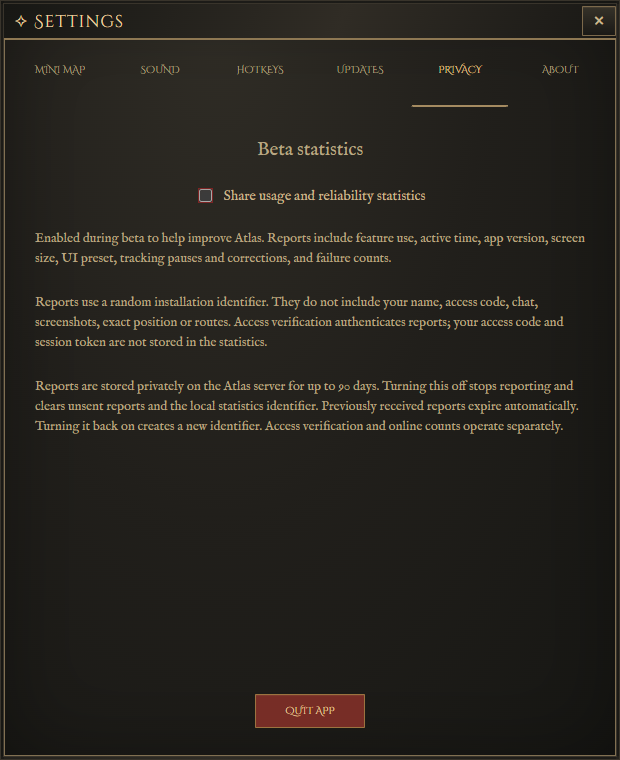

# Pax Dei Atlas beta testing

[Download 0.925 Beta for Windows x64](https://github.com/jayfunkdown/pax-dei-atlas-downloads/releases/download/v0.9.25/Pax-Dei-Atlas-Setup-0.9.25-x64.exe) · [Discord](https://discord.gg/YjJxCBbeJU)

1. Get your private beta access code from the project owner.
2. Download and run the official Setup file. It installs for your Windows account without administrator access.
3. Launch Atlas and enter the code. No email is requested. Valid saved access is remembered.
4. Log into Pax Dei, use the Medium game-UI baseline and open the in-game map with your player arrow visible to establish position.
5. Enable and size the minimap as desired. Try filters, favourites, flags, route tracing and named encounters. Test party tools with another tester using a separate party room code.

An internet connection is required to activate and validate access. Beta access stays valid until the project owner revokes it. Keep access codes private. The beta installer is not Windows publisher-signed yet; Windows may show an unknown-publisher or reputation prompt. Only download from this repository's release links.

## Things to test

- Tracking while stationary, walking, sprinting, crossing area boundaries, opening the game map, closing chat and returning from menus.
- Named cards, crafted-item tiers, drum volume, reentering a POI and moving between nearby POIs.
- Main map/minimap size, zoom, filters and favourites; shared flags and gold route lines.
- Relic/crafted-item search, direct pins for other provinces, multiple pins, Route checkboxes and gate guides.
- Market search and item icons, Qty/Stack/Total values, server-wide price watches and new-match notifications.
- Single-row toolbar, Recenter and the map selector below the map at different window widths.
- Party travel and Roll/Pass, Ready and Wait tools.
- Dungeon entry, maps, enemy roster and exit recovery.

## Current limits

Tracking is approximate. Wrong corrections, drift or brief pauses can occur; reopening the game map with the player arrow visible can help recovery. Named locations show potential spawns, not live enemy presence. Dungeon mode requires repeated recognition of the interior Zone / Biome: {biome} tag; approaching an entrance alone does not start dungeon cards. Atlas remembers the nearby overworld entrance to select the dungeon. There is no indoor position tracking. The overworld returns after fresh position evidence. Please test this behavior in real gameplay.

## Send feedback

Use the Discord bug-reports, feature-requests or feedback channels, or [GitHub Issues](https://github.com/jayfunkdown/pax-dei-atlas-downloads/issues). Include Atlas version, Windows resolution and display scale, game UI-size preset, expected behavior, actual behavior and reproduction steps. For tracking problems show the compass/game map and Atlas where possible. Remove access codes, private room codes and unrelated personal chat.

## Updating

Use Settings > Updates. If a newer beta is available, Update now downloads and verifies it, closes Atlas, installs into the same folder and reopens. Settings and valid saved access are retained. You can also close Atlas and run a newer official Setup over your existing installation without uninstalling. If an older beta closes without installing, use the official Setup download manually and reopen Atlas. This regular pre-1.0 beta may require updating before continuing.

## Beta statistics and privacy

Usage and reliability reporting is enabled by default during beta. You can turn it off in **Settings → Privacy**. Reports include feature use, observed activity time, version, display size/scale and game UI preset, tracking pauses/corrections, renderer failures and update results. A random installation identifier distinguishes device profiles; it is not a verified person. Access verification authenticates uploads, but access codes and session tokens are not stored in statistics. Technical reports can also include CPU/GPU models, driver and Windows versions, memory, monitor resolution/scale/refresh, game-window dimensions, sanitized errors and missing artwork references. Names, chat, screenshots, exact positions and travel routes are excluded. Closing session reports send automatically by default while reporting is enabled. You can disable automatic closing reports or all reporting in **Settings → Privacy**; if automatic sending is disabled, Atlas asks before closing. Crash recovery reports retry automatically when reporting is enabled. Usage reports are kept privately for up to 90 days; technical diagnostics for up to 30 days. Turning reporting off stops uploads and removes the local identifier and unsent reports; previously received reports expire automatically. Access checks and online counts remain separate.

