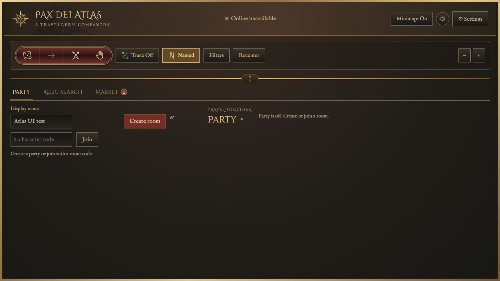
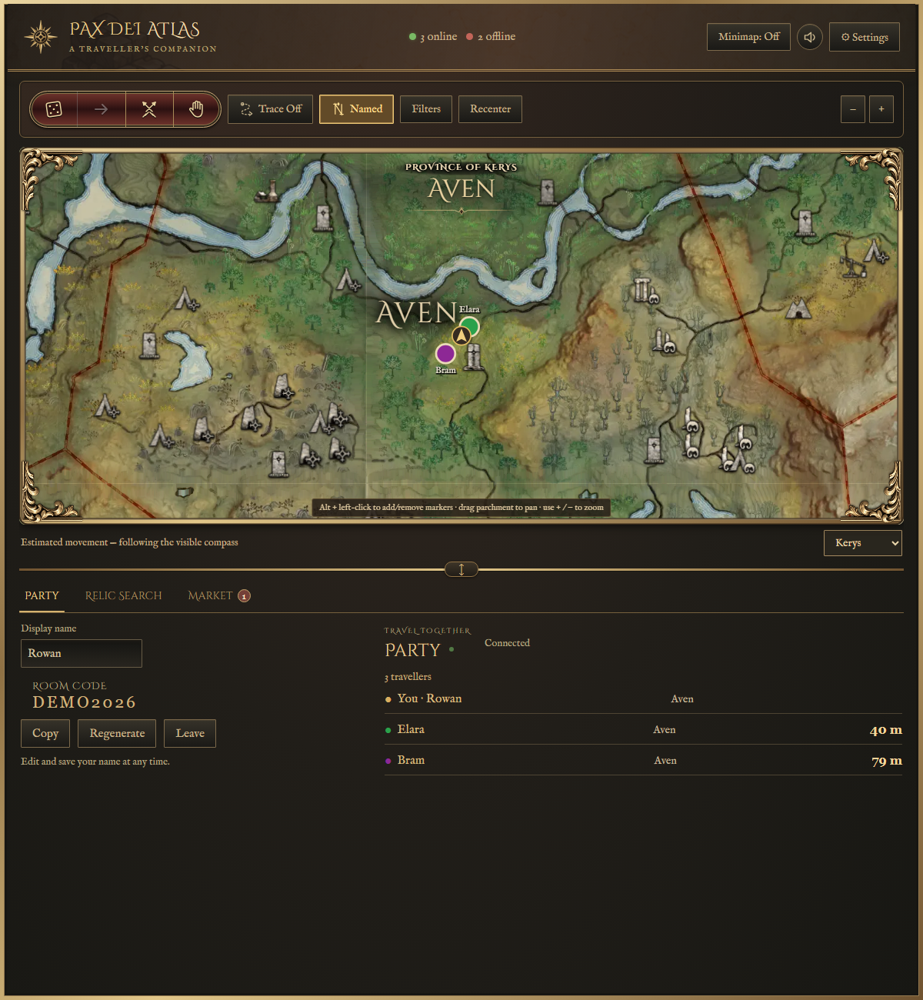
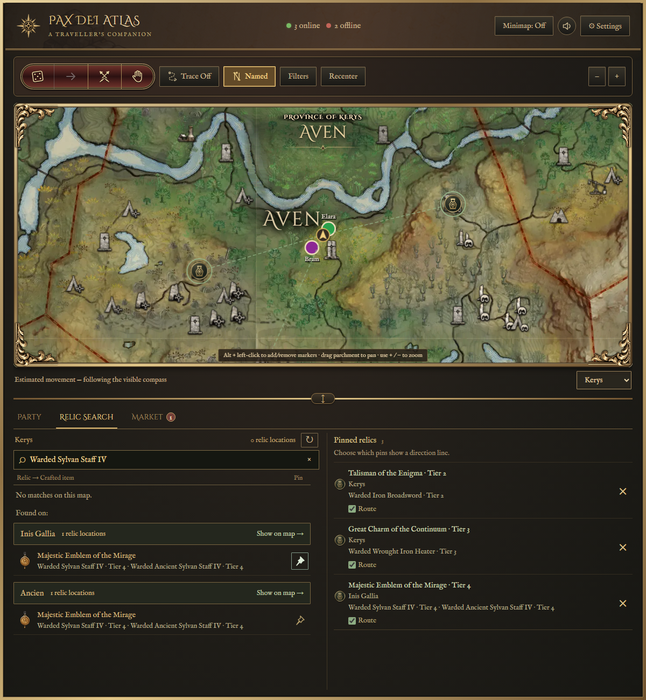
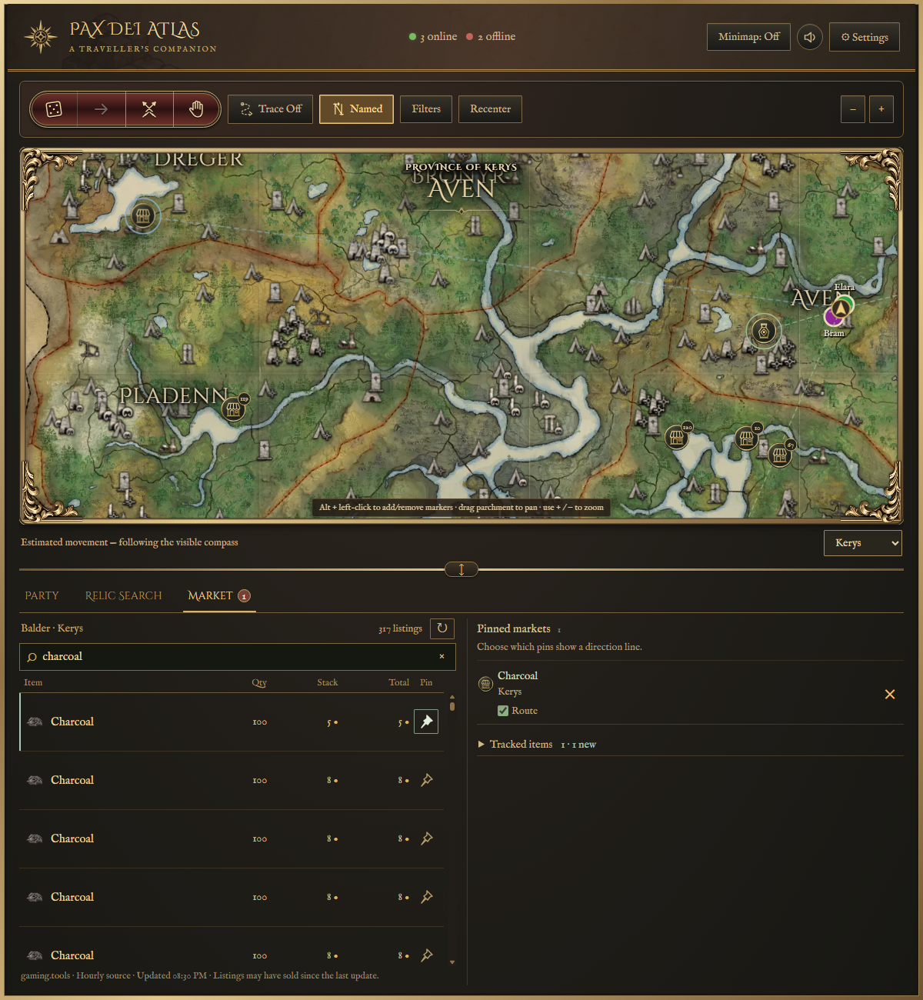
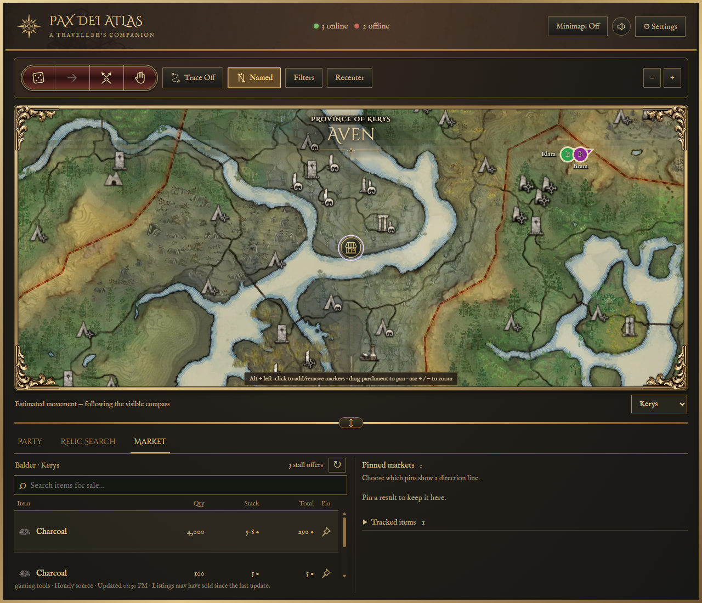

# Pax Dei Atlas feature guide

Atlas is a Windows map companion for Pax Dei. The current-location and combined-stock screenshots show the 0.926 interface (the stock preview predates the heading rearrangement). Other main-map and search screenshots show 0.924; 0.925 adds the fully collapsed map view. Other workflow images are from earlier beta builds and may have older styling. Screenshots use fictional party details and sample values; market prices shown are examples, not current offers. An invited-testers beta is now available; see [Beta testing](BETA-TESTING.md) for downloads and setup.

[Back to the project overview](README.md)

## Main map and position tracking

Drag the horizontal divider all the way up to fold away the map and give the lower panel the available space, including on 1280×720 screens. Drag down to reopen, or double-click to reset.

The gold **Current location:** heading sits above the map frame, with the province and area on one line and the existing fade effect. When viewing another map, the heading says **Viewing map:** instead.

The main map opens around your current area. Drag the parchment to pan, use the mouse wheel or the plus/minus controls to zoom, and choose another province from the selector below the map. Recenter returns to your current area. Crossing an area boundary keeps your chosen zoom. Small position corrections can move the marker without constantly moving the whole camera.

Atlas uses visible game-map and compass information, then estimates movement between position confirmations. Tracking accuracy can vary, especially after interruptions or when landmarks are unclear. During a brief unreadable compass interval, Atlas can keep estimating movement from the last heading for up to eight seconds; a longer outage pauses movement until a fresh heading arrives. Turns during that interval can reduce accuracy. If the marker needs correcting, opening the in-game map with the player arrow visible can help Atlas confirm its position. Panning the game map to scenery without a player arrow should not become a position fix.

## Minimap

The circular minimap provides a compact view while you play. Its controls include zoom, movement, route tracing, named-encounter notifications, settings and hiding the minimap. Party members outside the visible area have direction indicators near the edge.

The minimap can be shown or hidden independently of the main window. Close the main window when you want to quit Atlas.

## Map filters and pinned favourites

Choose the locations, resources, creatures and other map categories you want to see. Search for a particular entry, expand a category, or turn a group on or off. The filter panel opens over the map, leaving the map layout in place.

Pin up to four favourites to make frequently used filters accessible on both maps. For example, keep a useful resource type nearby without reopening the full filter list each time.

## Flags and the route trace

Use **Alt + left-click** on the map to add, replace or remove your flag. Party flags are shared so the group can agree on a destination; an off-screen flag retains a direction indicator.

Turn **Trace** on to show your recent route as a clear gold line with a dark outline. Small corrections can remain connected, while large position jumps start a separate section instead of drawing a long line across the map. The trail is temporary: disabling it clears it, and it starts fresh in a new app session. It is a route display, not an automatically calculated walking path.

Flags and Trace remain separate from pinned relic/market destination guides.

## Party travel and the movable divider

Create a room or join with a shared room code. The party panel shows travellers, their areas and approximate distances when their positions are available. Party markers and names also appear on the map.

Drag the divider between the map and the party panel to give either section more space. Make the map shorter to see more party members, or give it more of the window when you want to concentrate on navigation. The map can fold completely away beneath the toolbar, and the divider handle stays clear of the frame. Scrolling remains available when a section needs it.

Treat a real room code as an invitation to your group. The example below uses a fictional room rather than a live one.

## Roll and Pass

Start a roll from the action bar, or pass when you do not want to participate. Illustrated cards reveal each result. When the round finishes, the winning card rises and displays a **Winner** label. The group can see both rolls and passes together.

## Ready checks

Start a ready check before the group moves or begins an activity. Each traveller has a card showing **Ready** or **Not ready**, making it clear who is still outstanding. The pending check includes a countdown; once everyone is ready, the group sees **All ready**.

## Wait requests

Use **Wait** to ask the party to pause briefly. The request appears as a short notification with the requesting traveller's name. Party presentations are queued so competing requests and card sequences can be shown in order.

## Named enemies, relics and crafting results

When you approach a supported possible encounter, Atlas can display an illustrated set of cards: the named enemy, its special relic and a related crafting result. These describe known relationships; they do not detect whether that enemy is alive.

Borders follow the crafted item’s tier: II uses a simple brass border, III adds sculpted corner detail, and IV uses raised ornaments.

Mapped POIs trigger from about **65 metres** away; unmatched standalone locations use **90 metres**. Nearby enemies share their POI’s complete card sequence. New POI card groups queue after the current group. Surface discoveries retain their circle highlight and larger brass encounter-card replay icon for **15 minutes**. Click to replay the whole group; replay does not extend expiry, and walking away/back does not automatically repeat it during that window. Several discoveries can remain visible. After expiry, the next approach can trigger again.

One named-encounter dotted guide follows the last clicked replay or newly triggered encounter. Moving near another highlighted area does not clear that selection. The replay marker remains for its 15-minute window. Icons pulse slowly while their cards are playing. Named cards sit at the game viewport’s bottom centre, scale with resolution, and use an opaque heading at the Medium stamina-bar position. Surface cards no longer black out the minimap. Use Named to turn the feature off.

Some supported enemies have broader open-ground spawn zones, including reviewed areas in southwest Kerys. Those remain area highlights because a single tower marker would misrepresent their records. Several possible spawn locations do not mean that every displayed enemy can spawn at every point inside a combined area.

## Dungeon maps and encounter references

Supported dungeon pages provide map artwork and a reference to possible named enemies, relics and crafting results. Atlas displays a dungeon notice and pauses position tracking inside the dungeon; it does not claim to show your live position on the dungeon map. The overworld view returns after fresh position evidence. Approaching an entrance only highlights it: cards wait for the interior Zone / Biome tag, play once on entry, and cannot be replayed.

## Minimap appearance and HUD alignment

Choose a minimap size and adjust opacity. Party overlays use the Medium game-UI baseline; named cards scale with resolution and stay at the viewport bottom. Use **Reset overlay position** if the placement needs restoring. The minimap is circular.

## Sound and shortcuts

The sound setting controls Atlas effects such as roll winners, ready checks and named-enemy drums. Set the volume to zero to mute them.

The default shortcuts are **Alt + M** to show or hide the minimap, **Alt + I** to zoom in and **Alt + O** to zoom out. Click a binding in Settings to change it. If another application already uses a shortcut, choose a different binding or retry registration.

## Beta access and saved sign-in

An authorized beta access code unlocks Atlas. The app asks for the code, not an email address. Valid saved access is checked when the app opens; returning users should not see the unlock form during that check. The form is shown when access is missing, invalid or revoked. Beta access codes remain valid until the owner revokes them.

Online checks keep beta access revocable. Brief connection interruptions are allowed. A longer interruption can pause access, but the saved session is retained and can resume automatically when the connection returns. Updating the app keeps that saved session in the existing profile.

## Online/offline status

The top of the main window shows online and offline beta-access totals. These count valid access keys, not necessarily distinct people. A key with a recently verified active session is online; a valid key without one is offline. Names and access codes are not listed in these totals. The values in the screenshots are examples.

## Updates

Settings includes a manual update check. Packaged beta builds also check automatically after opening and periodically while running. When an approved newer version is published, the main map and minimap can display an update notice.

Click **Update now** to download the approved installer from the dedicated GitHub downloads repository. Atlas verifies the download before handing it to the installer, closes, installs into its existing folder and reopens. Settings and valid saved access remain in place.

The app reports that it is current when the installed version matches the published beta. This screenshot shows that state:

The next image illustrates how an offered update will look. It is a screenshot fixture illustrating the offer shown when a newer version is available:

## About and feedback

Atlas is a fan-made companion in active development. Feedback, ideas and reproducible bug reports are welcome on the [Atlas Discord](https://discord.gg/YjJxCBbeJU) and through this repository's Issues page. Discord has general chat, release notes, bug reports, feature requests and feedback. A website is planned.

Please do not include real beta codes, private room codes, personal information or unrelated player chat in public reports. Atlas is unofficial and is not affiliated with or endorsed by Mainframe Industries.

## Optional beta statistics

Settings → Privacy controls usage and reliability reporting, enabled by default for beta testing. Reports use a random installation identifier, are stored privately for up to 90 days, and exclude names, access codes, chat, screenshots, exact positions and routes. See the [tester guide](BETA-TESTING.md#beta-statistics-and-privacy) for details.

## Relic Search

Select **Relic Search** in the lower panel. Type a relic name or a crafted weapon/armour name; autocomplete helps with names, and the list underneath filters as you type. Results belong to the province selected on the main map.

Click a result to show its POI. Use its pushpin button to save it in the right column. Pinned relics show the relic tier, what it crafts and the crafted-item tiers. Relic locations come from the curated named-enemy encounter data; dungeon relics point to their entrances. Several relics at one POI share one map marker.

### Matches on another province

When nothing matches the selected province, Atlas lists matches elsewhere. **Show on map** switches the main map and fits the matching locations. The pin beside an individual result saves it without changing the map you are viewing. The minimap continues following your player location.

## Market search

Select **Market** to browse listings on your detected game server. With an empty search, the list starts with the selected province and result markers stay hidden. Click a row to show that one stall. Search with autocomplete to see matching offers across all maps on your server: the current map comes first, followed by the other maps. Matching markers appear on the currently viewed map as you type. Other-map results can be shown or pinned directly.

Offers for the same item, province and stall are combined when their item quality and normal stack size match. Rows with no reliable stall identity stay separate. Each row shows its item icon and three values:

| Column | Meaning |
| --- | --- |
| Qty | Total quantity available in the displayed stall offer. |
| Stack | Gold price for the item's normal full inventory stack; a range if combined stock has different prices. |
| Total | Sum of the actual gold cost for all quantity in that row. |

For example, a stall with 4,000 charcoal can show a 5–8 gold stack-price range and a 290 gold total. Tracked matches are filtered by the watch price before their qualifying stock is combined. A partial stack can have a Total lower than its Stack price; a bulk listing can have a higher Total. The same columns appear in search results, other-province results and tracked matches. Touching market markers merge at the current zoom, keeping crowded stalls readable.

Market data is supplied by **gaming.tools** and updates hourly. Listings may have sold since the last snapshot; Atlas does not claim that an item is still available in game.

## Market item watches

Open **Tracked items** on the right and choose **Track item**. Pick an exact item name using autocomplete. Optionally enter a **maximum gold per normal stack**, or leave it empty to watch for availability at any price. Watches cover every province on your detected server, rather than only the map currently displayed.

When a new matching listing appears in a checked snapshot, the Market tab receives a notification. The watch shows matching item icons, provinces, quantities, stack prices and totals. Click a matching listing to show it, or use its pin to save it without switching maps. **Mark notifications read** clears the badge; the remove button stops that watch. Checks run while Atlas is open and use the hourly source snapshots, so notifications are not instantaneous.

## Multiple pins and directional guides

Keep multiple relic and market destinations at once. Each pin has its own **Route** checkbox: show one guide, several guides or none, while keeping the pins saved. Green guides identify relic destinations; blue guides identify market destinations. Use the larger **×** to remove a pin. Pins and watch preferences persist between launches.

A destination in another province routes first to a connecting gate, marked with the destination’s relic or market symbol, then continues from the arrival gate. These are straight direction guides, not walking-path navigation. Changing the viewed main-map province does not change where your player is tracked.

Approaching a relic POI or playing named cards does not delete its pin. The named replay icon takes visual priority at that POI, and named-encounter tracking remains independent of relic and market guides. The gold player arrow renders above the map icons so a nearby replay/stall symbol cannot cover it.

### Search map results in 0.926

Relic Search and Market display matching locations on the main map as you type. Opening a tab with an empty search does not add all results to the map. Clicking a listed result while the search is empty reveals only that selected destination; hovering does not populate an empty map. Clearing the search hides temporary result icons while keeping saved pins and their routes.

