# Pax Dei Atlas feature guide

Atlas is a Windows map companion for Pax Dei. This guide shows the current beta interface. Screenshots use a fictional party and sample values; the interface and behavior may change during development. No public installer or release candidate is available yet.

[Back to the project overview](README.md)

## Main map and position tracking

The main map opens around your current area. Drag the parchment to pan, use the mouse wheel or the plus/minus controls to zoom, and choose another province from the map selector. Crossing an area boundary keeps your chosen zoom. Small position corrections can move the marker without constantly moving the whole camera.

Atlas uses visible game-map and compass information, then estimates movement between position confirmations. Tracking accuracy can vary, especially after interruptions or when landmarks are unclear. During a brief unreadable compass interval, Atlas can keep estimating movement from the last heading for up to eight seconds; a longer outage pauses movement until a fresh heading arrives. Turns during that interval can reduce accuracy. If the marker needs correcting, opening the in-game map with the player arrow visible can help Atlas confirm its position. Panning the game map to scenery without a player arrow should not become a position fix.

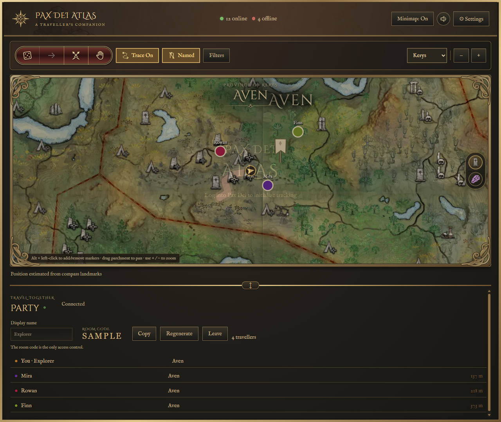

## Minimap

The circular minimap provides a compact view while you play. Its controls include zoom, movement, route tracing, named-encounter notifications, settings and hiding the minimap. Party members outside the visible area have direction indicators near the edge.

The minimap can be shown or hidden independently of the main window. Close the main window when you want to quit Atlas.

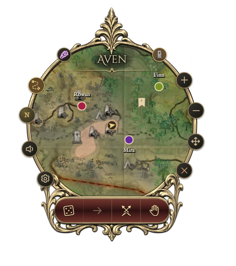

## Map filters and pinned favourites

Choose the locations, resources, creatures and other map categories you want to see. Search for a particular entry, expand a category, or turn a group on or off. The filter panel opens over the map, leaving the map layout in place.

Pin up to four favourites to make frequently used filters accessible on both maps. For example, keep a useful resource type nearby without reopening the full filter list each time.

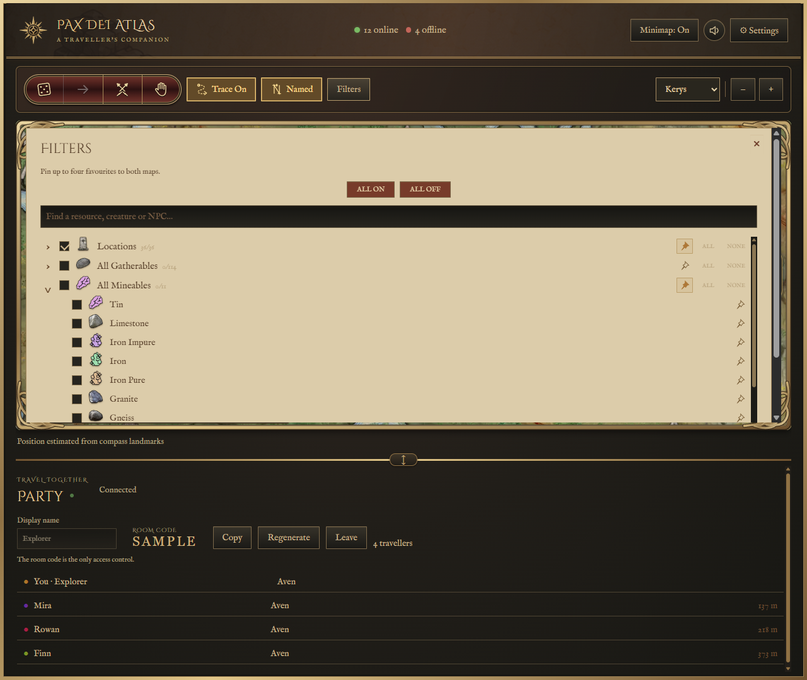

## Flags and the route trace

Use **Alt + left-click** on the map to add, replace or remove your flag. Party flags are shared so the group can agree on a destination; an off-screen flag retains a direction indicator.

Turn **Trace** on to show your recent route as a broad peach highlight. Small corrections can remain connected, while large position jumps start a separate section instead of drawing a long line across the map. The trail is temporary: disabling it clears it, and it starts fresh in a new app session. It is a route display, not an automatically calculated walking path.

The main-map screenshot above includes an example flag and peach trail.

## Party travel and the movable divider

Create a room or join with a shared room code. The party panel shows travellers, their areas and approximate distances when their positions are available. Party markers and names also appear on the map.

Drag the divider between the map and the party panel to give either section more space. Make the map shorter to see more party members, or give it more of the window when you want to concentrate on navigation. Scrolling remains available when a section needs it.

Treat a real room code as an invitation to your group. The example below uses a fictional room rather than a live one.

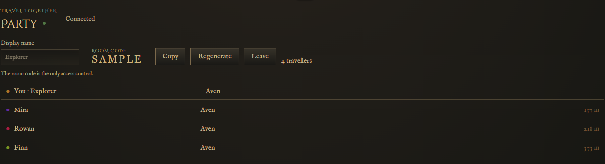

## Roll and Pass

Start a roll from the action bar, or pass when you do not want to participate. Illustrated cards reveal each result. When the round finishes, the winning card rises and displays a **Winner** label. The group can see both rolls and passes together.

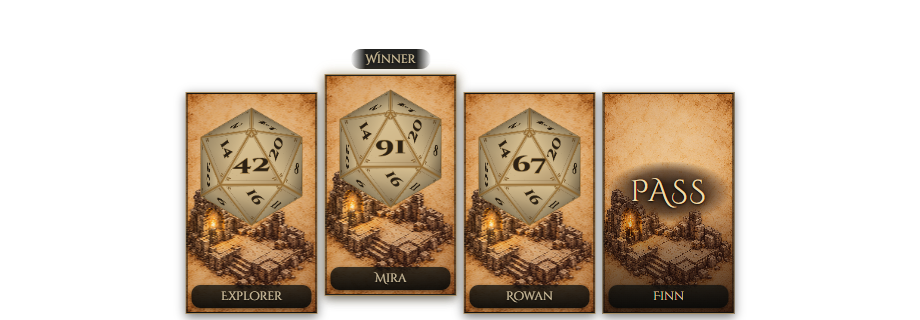

## Ready checks

Start a ready check before the group moves or begins an activity. Each traveller has a card showing **Ready** or **Not ready**, making it clear who is still outstanding. The pending check includes a countdown; once everyone is ready, the group sees **All ready**.

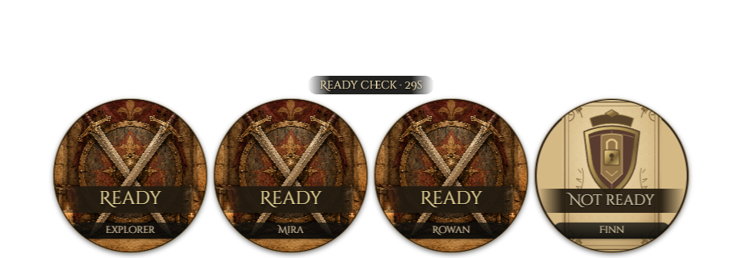

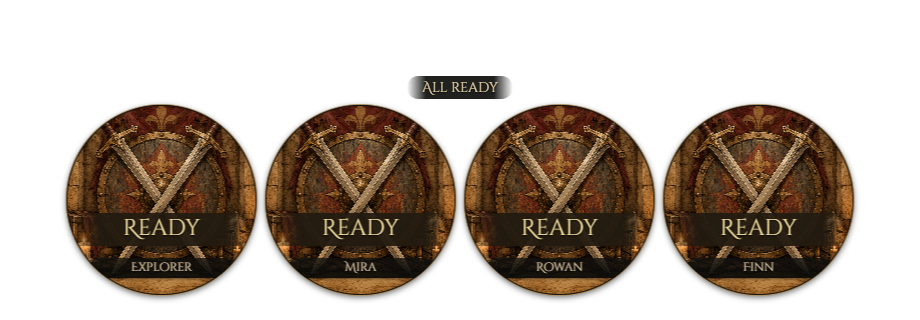

## Wait requests

Use **Wait** to ask the party to pause briefly. The request appears as a short notification with the requesting traveller's name. Party presentations are queued so competing requests and card sequences can be shown in order.

## Named enemies, relics and crafting results

When you approach a supported possible encounter, Atlas can display an illustrated set of cards: the named enemy, its special relic and a related crafting result. These describe known relationships; they do not detect whether that enemy is alive.

Tower-linked records activate **one POI at a time**. Multiple named enemies mapped to that POI share one small highlight and its card sequence. Entering another tower replaces those cards, even when the same enemy has a recorded spawn at both towers. Notifications currently begin about **65 metres from the mapped POI** (or the recorded point when there is no matching POI). This is a test distance and may be tightened. The highlight stays until you move beyond 100 metres or switch to another POI. A small switching margin helps avoid flickering during position corrections. There is no cooldown: leaving or switching away rearms the POI immediately, so returning can show its cards again. Staying inside does not repeatedly replay them. Use the Named toggle to turn these notifications off.

Some supported enemies have broader open-ground spawn zones, including reviewed areas in southwest Kerys. Those remain area highlights because a single tower marker would misrepresent their records. Several possible spawn locations do not mean that every displayed enemy can spawn at every point inside a combined area.

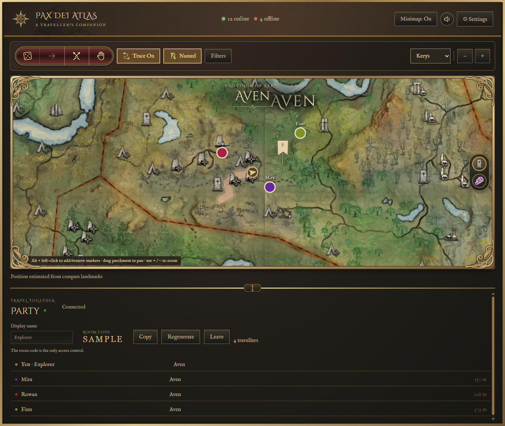

## Dungeon maps and encounter references

Supported dungeon pages provide map artwork and a reference to possible named enemies, relics and crafting results. Atlas displays a dungeon notice and pauses position tracking inside the dungeon; it does not claim to show your live position on the dungeon map. The overworld view returns when Atlas recognizes that you have left.

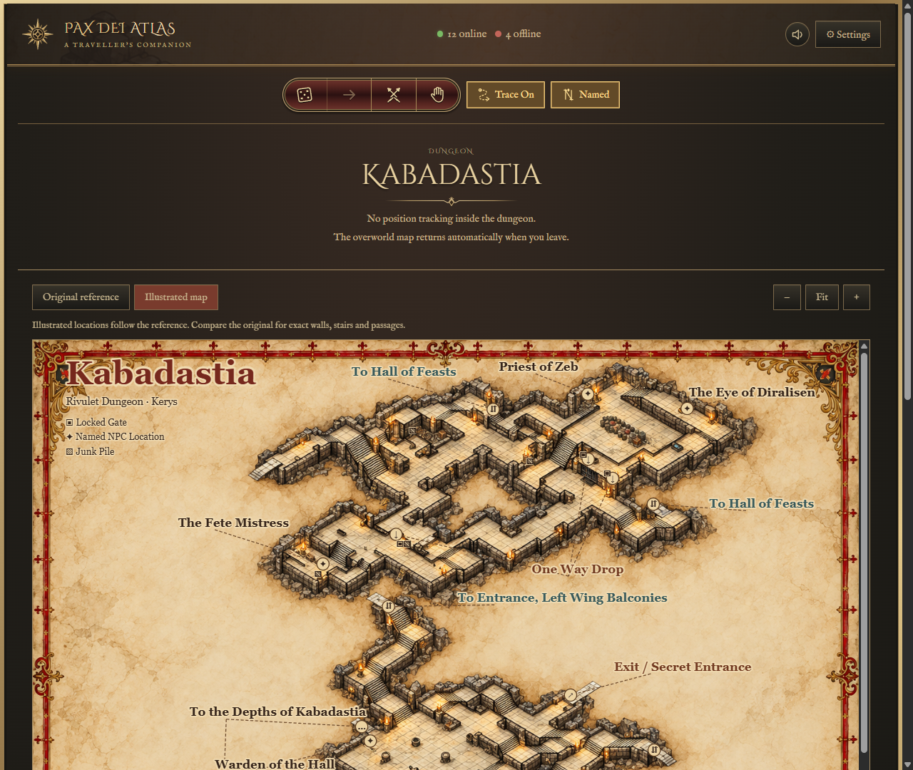

## Minimap appearance and HUD alignment

Choose a minimap size or a custom size, adjust opacity, and match Atlas to the game's UI-size preset so cards align with the HUD. Use **Reset overlay position** if the placement needs restoring. The minimap is circular.

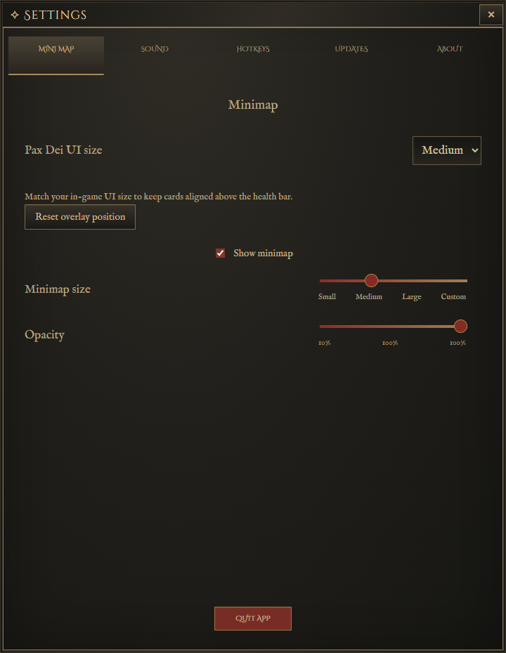

## Sound and shortcuts

The sound setting controls Atlas effects such as roll winners, ready checks and named-enemy drums. Set the volume to zero to mute them.

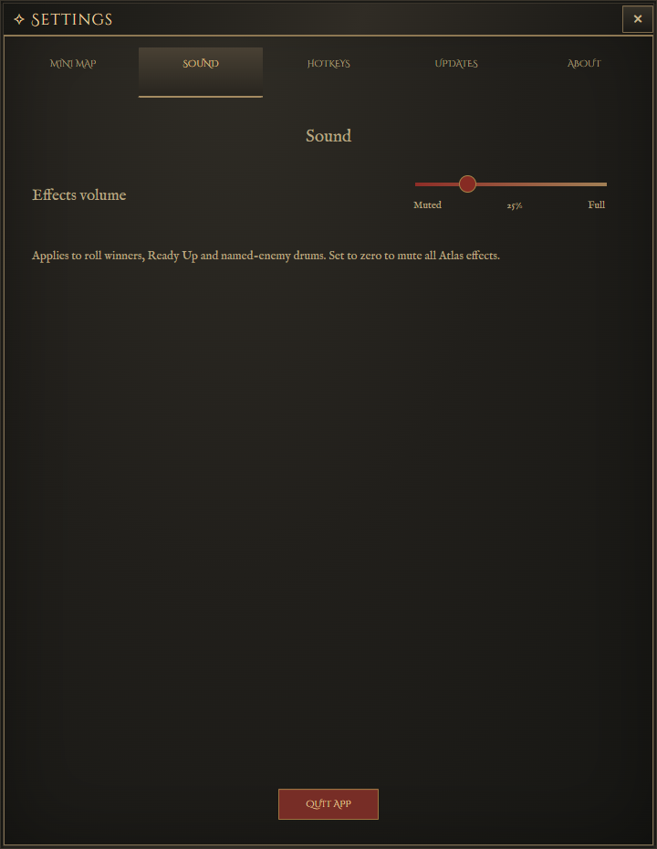

The default shortcuts are **Alt + M** to show or hide the minimap, **Alt + I** to zoom in and **Alt + O** to zoom out. Click a binding in Settings to change it. If another application already uses a shortcut, choose a different binding or retry registration.

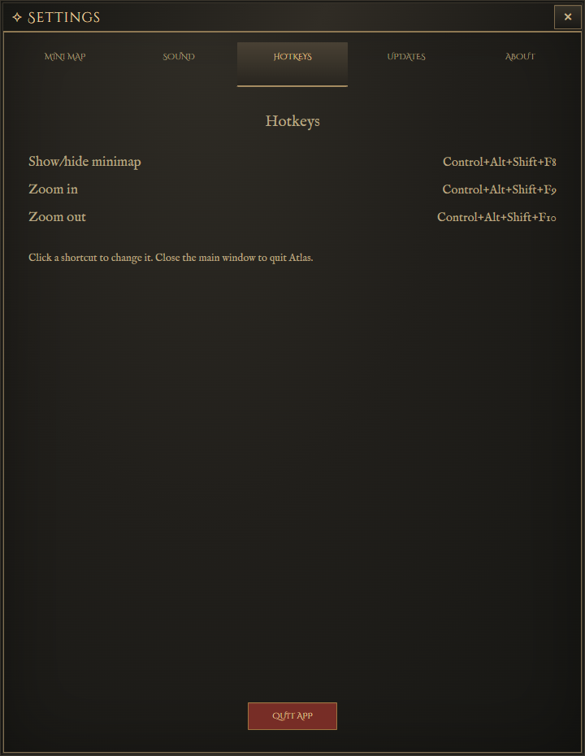

## Beta access and saved sign-in

An authorized beta access code unlocks Atlas. The app asks for the code, not an email address. Valid saved access is checked when the app opens; returning users should not see the unlock form during that check. The form is shown when access is missing, expired or cancelled.

Online checks keep beta access revocable. Brief connection interruptions are allowed. A longer interruption can pause access, but the saved session is retained and can resume automatically when the connection returns. Updating the app keeps that saved session in the existing profile.

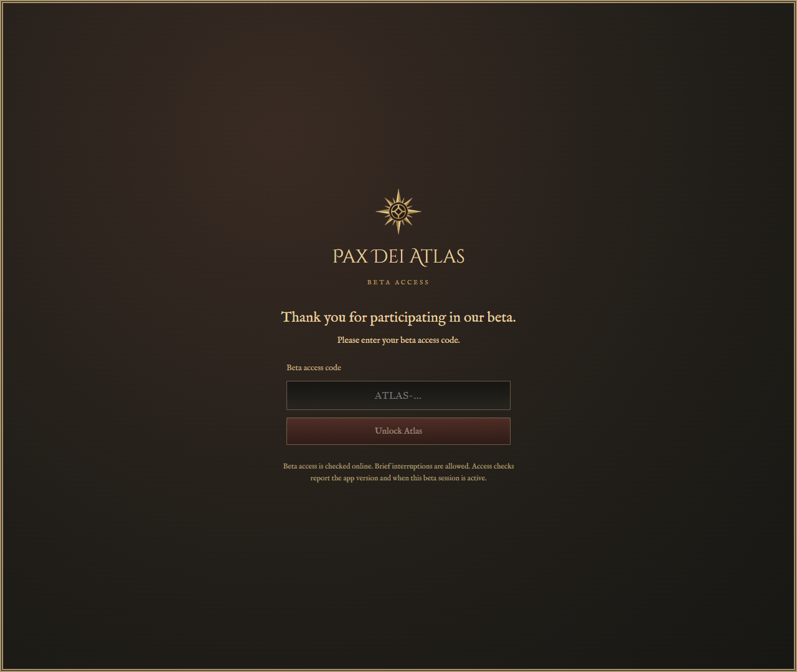

## Online/offline status

The top of the main window shows online and offline beta-access totals. These count valid access keys, not necessarily distinct people. A key with a recently verified active session is online; a valid key without one is offline. Names and access codes are not listed in these totals. The values in the screenshots are examples.

## Updates

Settings includes a manual update check. Packaged beta builds also check automatically after opening and periodically while running. When an approved newer version is published, the main map and minimap can display an update notice.

Click **Update now** to download the approved installer from the dedicated GitHub downloads repository. Atlas verifies the download before handing it to the installer, closes, installs into its existing folder and reopens. Settings and valid saved access remain in place.

**No update is currently published.** This is the normal current screen:

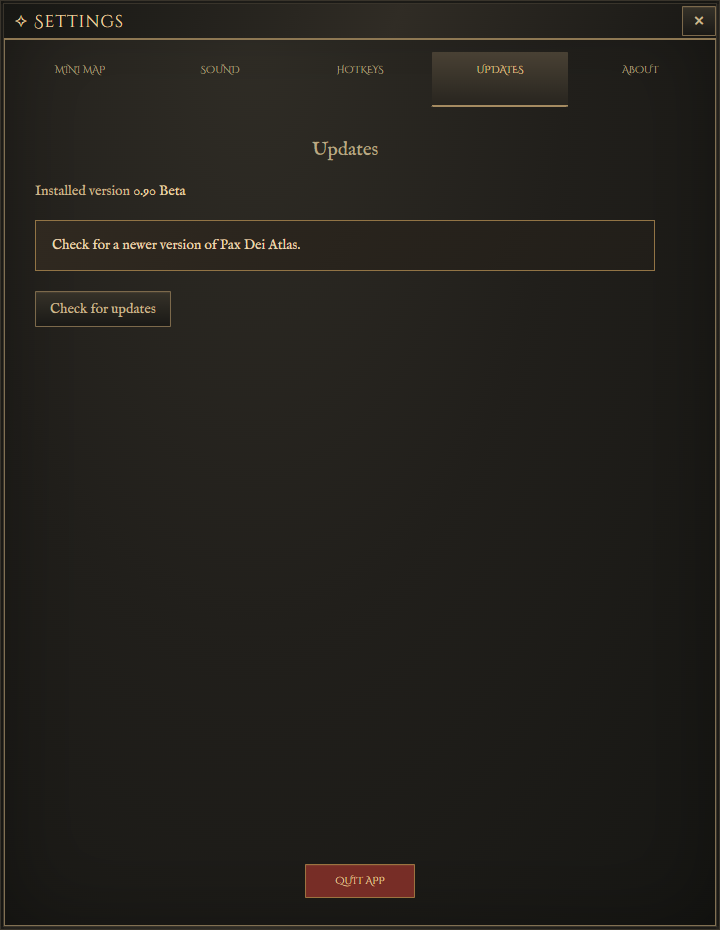

The next image illustrates how an offered update will look. It is a private screenshot fixture, not an announcement of an available download:

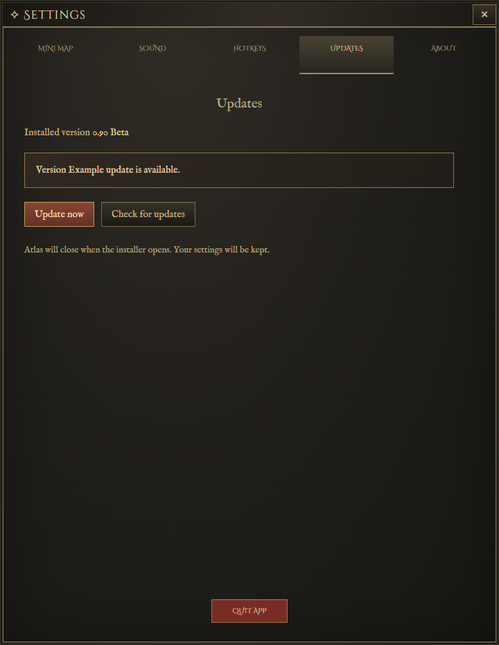

## About and feedback

Atlas is a fan-made companion in active development. Feedback, ideas and reproducible bug reports are welcome through this repository's Issues page. Discord and website links will be added when they are available.

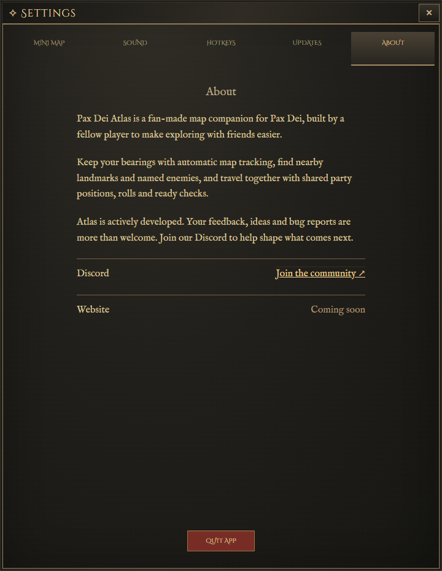

Please do not include real beta codes, private room codes, personal information or unrelated player chat in public reports. Atlas is unofficial and is not affiliated with or endorsed by Mainframe Industries.
