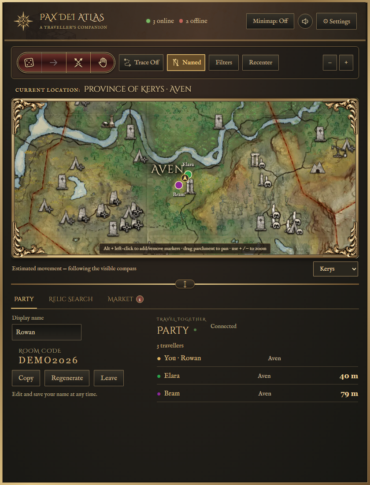
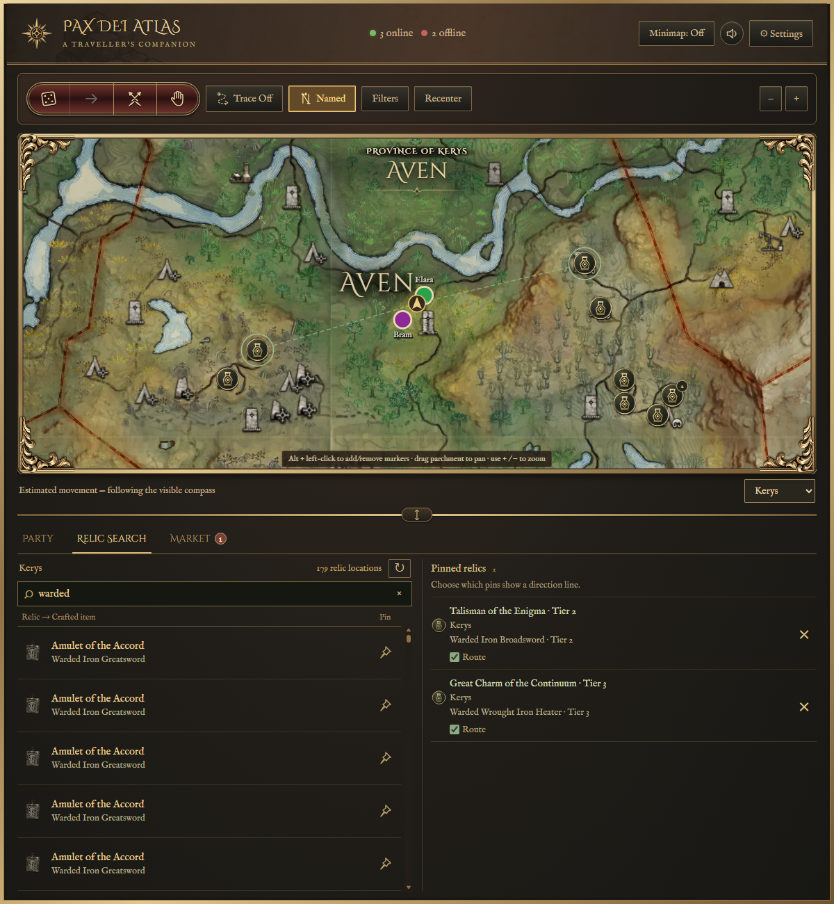
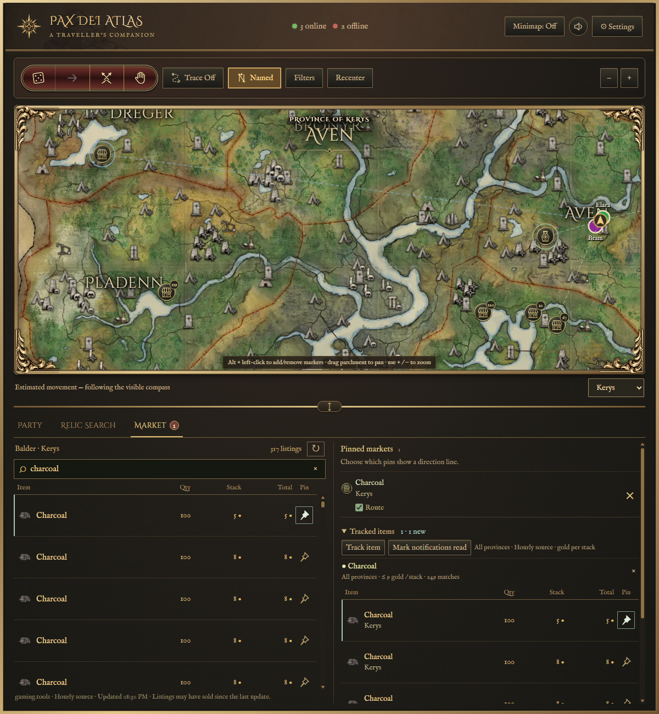

# Pax Dei Atlas

**A map companion for exploring Pax Dei together.**

Pax Dei Atlas brings a readable main map, an adjustable minimap, Relic Search, server market listings, item-price watches, party tools and illustrated encounter references into one Windows companion app. Keep your group together, mark a destination, check nearby points of interest, and make the next adventure easier to organize.

## Beta status

**0.927 Beta is available for invited testers on Windows 10/11, 64-bit.**

**[Download Pax Dei Atlas Beta](https://github.com/jayfunkdown/pax-dei-atlas-downloads/releases/download/v0.9.27/Pax-Dei-Atlas-Setup-0.9.27-x64.exe)** · [Release notes](https://github.com/jayfunkdown/pax-dei-atlas-downloads/releases/tag/v0.9.27) · [Tester quick start](BETA-TESTING.md)

A private beta access code is required to unlock the app. Codes are supplied individually; none are published here. The installer includes the artwork and supporting runtime, and installs for your Windows account without administrator access. This early beta is not Windows publisher-signed yet, so Windows may show an unknown-publisher or reputation prompt. Use the official download linked above.

Beta usage and reliability reporting is enabled by default. You can turn it off in **Settings → Privacy**. Reports use a random installation identifier and exclude names, codes, chat, screenshots and exact locations. Reports are stored privately for up to 90 days.

This public repository contains feature information, screenshots and beta downloads. Application source is maintained separately in a private repository.

## What Atlas includes

| Feature | What it does |
| --- | --- |
| Main map | Pan and zoom, see your approximate position, and adjust the space shared with the party panel. |
| Minimap | A circular map with adjustable size and opacity, convenient controls and party directions. |
| Filters and favourites | Choose which locations, resources, creatures and other map entries to show; pin favourites on the main map, with the first four also on the minimap. |
| Shared flags and trails | Mark a destination and follow a gold line recording of your recent route. |
| Party travel | Join with a room code, see shared party positions and check each traveller's area and approximate distance. |
| Roll, Pass, Ready and Wait | Make group decisions with animated cards, a winner indicator, ready checks and short wait requests. |
| Named encounters | See possible spawn locations and illustrated enemy, relic and crafting-result cards. |
| Dungeon references | View supported dungeon maps and encounter information. Position tracking pauses inside dungeons. |
| Relic Search | Find relics and crafted items, see tiers, and keep multiple route pins. |
| Market and watches | Browse server/province listings, compare quantity/stack/total prices, and watch for new matching offers. |
| Beta access and updates | Unlock with a beta access code, retain saved access, and install future approved updates from inside Atlas. |

## New in 0.927

Improved recovery after same-area home ports, respawns and zone crossings; expanded main-map filter favourites with scrolling and Escape to close Filters; clearer text and search-pin visibility; corrected resource and wolf-cave map records. Live tracking testing continues. [Full release notes](RELEASE-0.927.md).

## Relic Search and market tools

Search for relics or what they craft, keep several destinations pinned, and choose which directional guides you want to see. Browse market listings with quantity, normal-stack price and total cost, or watch an item across your server for a matching offer.

### Relic Search and persistent pins

### Market listings and tracked offers

The new screenshots use the actual 0.924 renderer, fictional party details and example market snapshots. Prices shown are examples, not current offers.

**[Open the complete feature guide and screenshot gallery →](FEATURES.md)**

## A few things to know

- Tracking is approximate. Atlas reads visible game-map and compass information and estimates movement between confirmations. It can need another clear view of the in-game map to correct its position.
- Named-enemy locations are potential spawn records, not confirmation that an enemy is alive or currently present.
- Screenshots show the actual beta interface with fictional party details and sample status/market values. Older workflow images are labelled in the feature guide. The update-available screenshot is an illustration; your installed version determines whether an update is offered.
- A beta access code unlocks Atlas. A party room code invites someone to your group; these are different codes.

## Feedback

Ideas, usability feedback and reproducible bug reports are welcome through [GitHub Issues](https://github.com/jayfunkdown/pax-dei-atlas-downloads/issues). Include the app version and what happened. Please remove access codes, private room codes, personal details and unrelated chat messages from screenshots before posting.

[Join the Pax Dei Atlas Discord](https://discord.gg/YjJxCBbeJU) for community chat, release notes, bug reports, feature requests and feedback. A dedicated website is planned.

Pax Dei Atlas is an unofficial fan-made companion and is not affiliated with or endorsed by Mainframe Industries. Pax Dei and its game assets belong to their respective owners.
